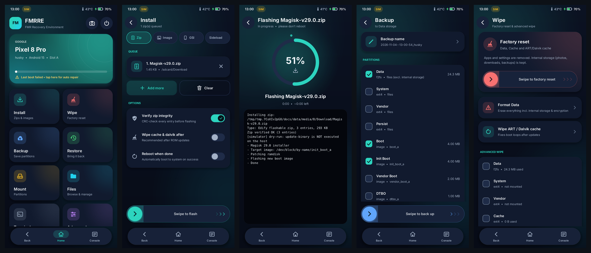
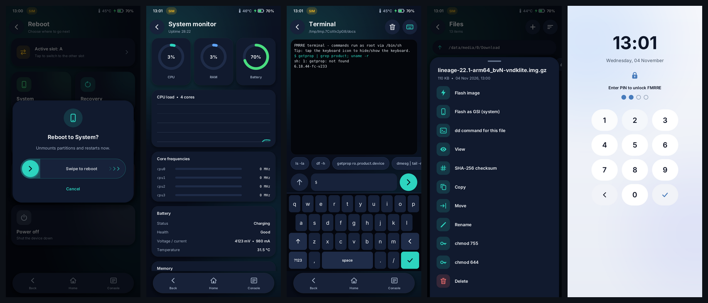
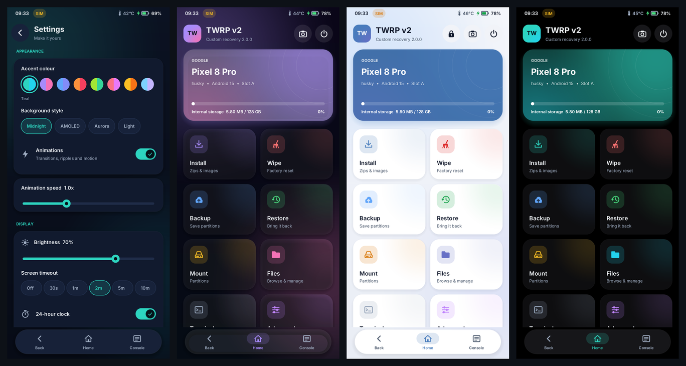
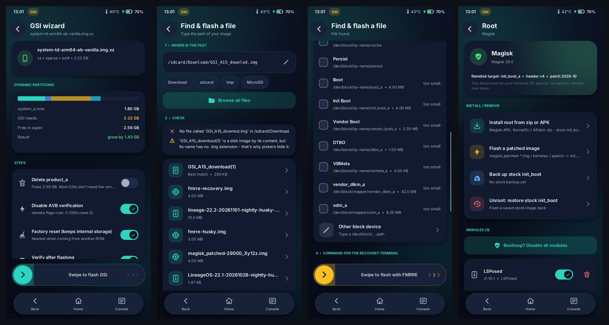
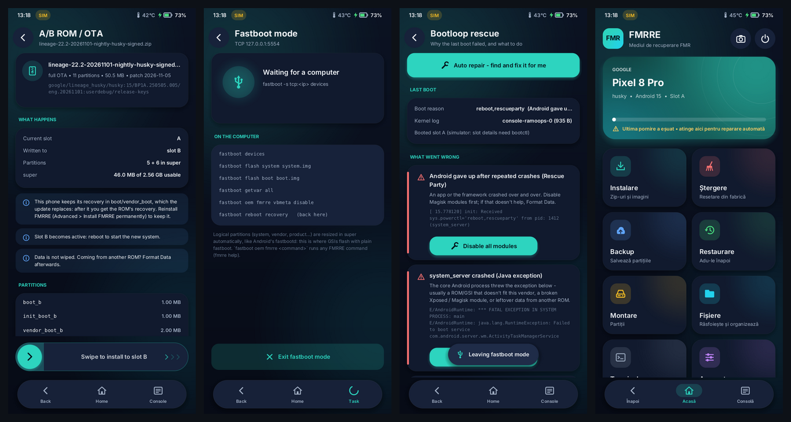
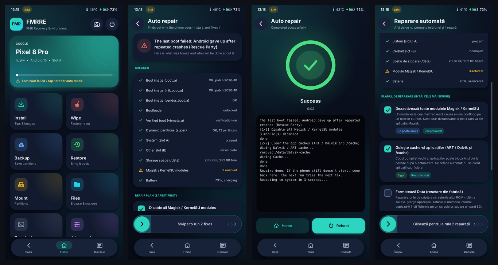
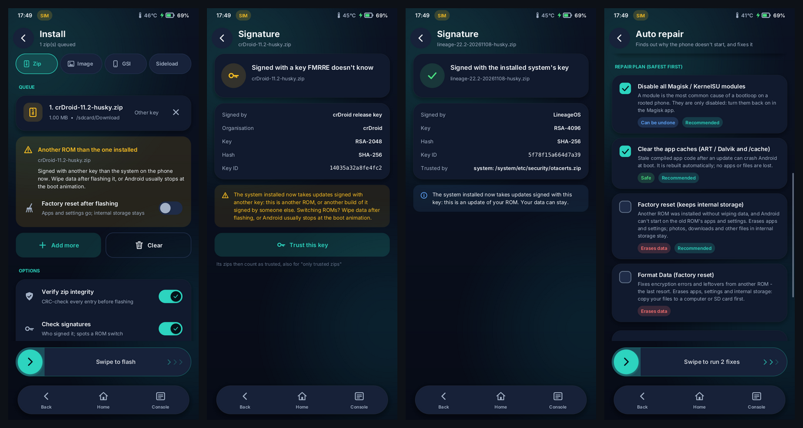
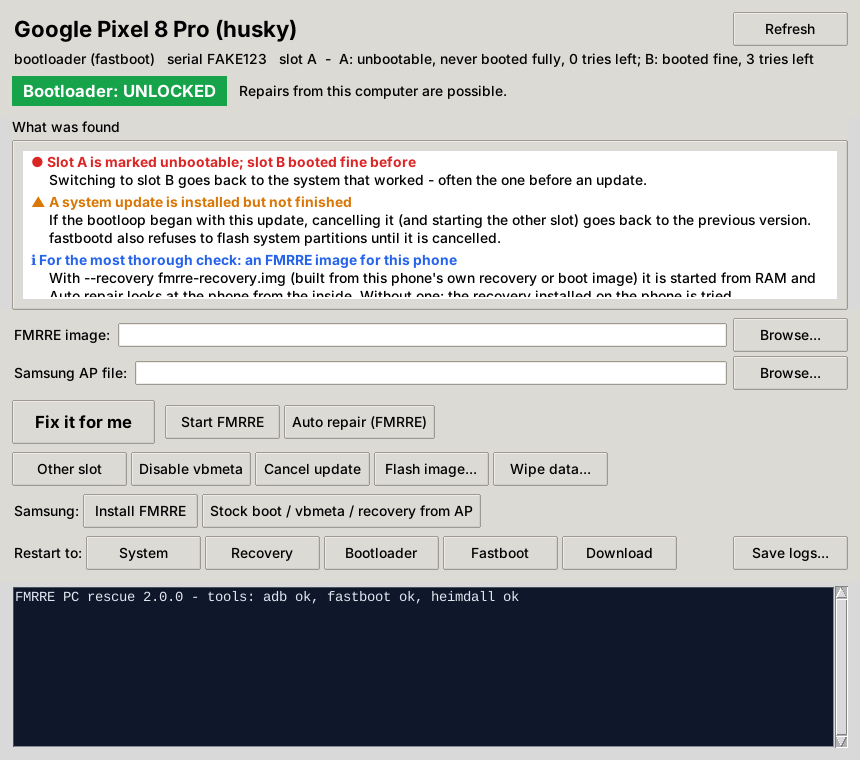

# FMRRE - FMR Recovery Environment

**A modern, native Android custom recovery, rebuilt from scratch with a fresh interface and many more features.**

*Formerly "TWRP v2". It is its own project, not affiliated with TeamWin's TWRP, but it speaks TWRP's languages:
TWRP fstabs, OpenRecoveryScript, the `twrp` command and classic TWRP backups all keep working.*

[Citește în română](README.ro.md)

FMRRE is a real recovery environment: a single static binary that `init` starts from the recovery
ramdisk. It draws directly to the display (DRM/KMS or fbdev), reads the touchscreen and buttons from
`/dev/input`, and does the work itself: it flashes zips and images, makes backups, wipes, mounts and more.
It does not need Android, a framework or a GPU.









> **Status: experimental - NOT tested on a real phone yet.** Everything here builds (host and static binaries
> for 7 CPU architectures, each one also run on an emulated CPU with qemu-user), runs in the desktop simulator
> and passes the self-tests (real `update-binary` protocol, sparse
> and compressed images, super metadata rewrite, backup → wipe → restore, OpenRecoveryScript, A/B OTA payloads
> with bzip2/xz and on-device dm-verity/FEC, checked against independent implementations). Its fastbootd is driven
> by the real `fastboot` client in the tests (over TCP; the USB FunctionFS path needs a phone). The features that
> touch `super`, `vbmeta`, `misc` and device-mapper follow the AOSP on-disk formats exactly and are covered by
> tests, but they have **never run on hardware**. Always try it with `fastboot boot` first, keep a working
> recovery, and keep the super/vbmeta/boot backups FMRRE makes automatically.

---

## What's new compared to classic TWRP

### Interface
- **Material-style UI, rendered in software.** Anti-aliased rounded cards, soft shadows, glows,
  ripples, a floating nav dock and animated page transitions, with no GPU needed. A full 1080×2400 frame takes
  about 8–16 ms on one desktop-class CPU core. The screen is only redrawn while something moves, so the
  recovery uses no CPU when idle.
- **4 background styles and 8 accent colours:** Midnight, AMOLED (pure black), Aurora (animated glow)
  and Light.
- **Languages: English and Română** (Settings → Language, switches instantly). Translation happens in the font
  layer, so every screen gets it; text that isn't in the dictionary (file names, logs, terminal output) stays as it
  is. The fonts include Latin-1, Latin Extended-A and ș/ț (`tools/subset_fonts.py` rebuilds them).
- **Crisp at any density:** TrueType fonts (Inter plus DejaVu Sans Mono) and a vector icon set rasterised
  from signed-distance shapes. There are no bitmap themes to port per resolution.
- **Swipe-to-confirm** on every destructive action, plus a **typed "yes"** to format data. Below 10% battery (not
  charging) every operation asks first: a flash cut short by a dead battery can leave a phone unbootable.
- **Kinetic scrolling** with overscroll bounce, long-press, multi-select, an on-screen keyboard with key
  previews, toasts, bottom sheets and dialogs.
- **Live status bar:** clock, CPU temperature and battery level/charging.
- **Console drawer:** the full colour-coded log is one tap away, with a button to save it to storage.
- **Hardware-key navigation:** Vol+/Vol− move focus, Power selects. It works even with a broken touchscreen.
- **PIN lock** on boot and when the screen turns off, **screen timeout** (dim, then blank), haptics,
  a brightness slider, 180° rotation and a **notch offset**.
- **Screenshots** with Vol− + Power, the camera icon, or Advanced → Take screenshot.

### Recovery features
| Area | Features |
|---|---|
| **Install** | Zip **queue**, CRC **integrity check** before flashing, real `update-binary` protocol (`ui_print`, `progress`, `set_progress`, `wipe_cache`), zip type detection (Edify, script, Magisk/KSU module, A/B OTA), optional cache/ART wipe and auto-reboot afterwards |
| **A/B ROMs & OTAs** | Flash **`payload.bin` zips** (LineageOS & co. on A/B phones, full factory OTAs) natively, no `update_engine` needed: REPLACE / bzip2 / xz / ZERO operations (bzip2 decoder built in), every block checked against its **SHA-256**, dynamic partitions **re-laid out in super** like update_engine (on Virtual A/B phones the current slot is freed only if super is too small), the **dm-verity hash tree and FEC computed on the phone** exactly like Android does (modern OTAs leave them out), a hash check of every finished partition, then a **slot switch**. Installs go to the **inactive slot**, so a failed install leaves your current system untouched. **update_engine's signatures** inside `payload.bin` are checked too - the metadata signature (it vouches for every block's hash) on every install, the whole-payload signature with `fmrre payload verify` - against the installed system's `update-payload-key.pub.pem` / `otacerts.zip`, the recovery's and your keys, and the zip's own signing key. **Extract images** too, e.g. `boot.img` / `init_boot.img` for Magisk, with verity filled in so they match the factory images. Incremental OTAs and foreign-device packages are refused with an explanation |
| **fastbootd built in** | `fastboot reboot fastboot`, `adb reboot fastboot` or Advanced → Fastboot mode lands in FMRRE's **own userspace fastboot**: `flash` (raw and sparse, split images), logical partitions **resized in super automatically** (so `fastboot flash system gsi.img` just works), `create/resize/delete-logical-partition`, `update-super` / `wipe-super` and `fastboot update` factory zips (also the newer clients' whole-`super` flash), `erase`, `fetch`, `set_active`, `getvar all`, `reboot` to anywhere, and **`fastboot oem fmrre <command>`** to run any FMRRE command from the computer. USB through FunctionFS like AOSP's fastbootd (Windows gets WinUSB descriptors), or TCP (`fastboot -s tcp:IP`) for emulators. Tested against the real `fastboot` client |
| **Zip signatures** | Checks the **whole-file signature** of ROMs and OTAs exactly like Android's own recovery (signapk format: PKCS#7 without signed attributes, RSA PKCS#1 v1.5 with SHA-1 / SHA-256 and ECDSA P-256 - all built in, no OpenSSL) and says **whose key** signed it: the **installed system's** (an update of your ROM), one this recovery trusts (its `otacerts.zip`, or `/res/keys` of recoveries before Android 10 - every mincrypt key version, e=3 too), one you trust (`FMRRE/keys`, "Trust this key"), the **public AOSP test key** (anyone can sign with it), or an unknown one. A **ROM signed with another key than the installed system** is a ROM switch: FMRRE warns to wipe data before you flash it - starting a ROM on another ROM's data is a classic bootloop - and writes the signer to the flash history. A zip changed after it was signed, or a second end-of-zip record hidden after the real one, is caught. Optional: **only install zips signed with a trusted key**. `fmrre verify-zip <zip>` prints the verdict |
| **ADB sideload** | `adb sideload rom.zip` works with **FMRRE's own adb** - no `minadbd` in the ramdisk needed: the device side of the adb protocol (the connection, the `sideload-host` block protocol and the old `sideload` one, `adb reboot ...`) over the USB function adbd uses (FunctionFS, with the Windows driver descriptors), or over TCP in the simulator. The package is stored where it fits (internal storage, /cache or RAM), goes through the same verified installer (CRC, signatures), and **adb on the computer exits with the install result**. `fmrre sideload [--tcp PORT]` |
| **Images** | Flash **raw and Android sparse** images that are also **`.xz`, `.gz`, `.zst`, `.lz4` or inside a `.zip`** - streamed, no temp files (xz, **LZ4** and **Zstandard** decoders built in - Samsung's `.img.lz4` and `.img.zst` GSIs flash directly, with no tool in the ramdisk; every checksum the formats have is checked). Target picked from the image *content* (boot / init_boot / vendor_boot / vbmeta / dtbo / super / system), fit check, optional archive pre-check, **SHA-256 read-back verify**, logical partitions remapped read-write (the reason plain `dd` fails on `system_a`) |
| **GSI wizard** | Pick a GSI in any format → checks it fits → **grows `system_a` inside super** (optionally frees the other slot or deletes `product_a`) → streams it → **disables AVB in vbmeta** → optional factory reset. Refuses while a Virtual A/B update is merging |
| **Super partitions** | Reads and rewrites the LP metadata like fastbootd: usage map, groups, **resize / delete / create** logical partitions, free the inactive slot, map read-write, **automatic metadata backup + restore** before every change (written to all slots, backup copy first, verified by read-back) |
| **Find & flash a file** | "Can't find your file?": type a path (`/sdcard/...` is mapped to recovery's real path), get a **diagnosis** (wrong folder, typo with fuzzy suggestions, unfinished download, encrypted or unmounted storage, missing extension - files are recognised by their content) and a **ready-to-run command** (`dd`, `xz -dc \| dd`, `simg2img` for sparse, `blockdev --setrw` for logical partitions) to open in the terminal, save as a script, or flash with the built-in streamer |
| **Verified boot** | Show and change vbmeta flags for both slots (`--disable-verity --disable-verification` equivalent), original header saved first; flashing a `vbmeta.img` can patch it on the fly |
| **Install FMRRE** | From a computer: `scripts/install.sh` / `install.ps1` handle **fastboot** (test boot or permanent, A/B slots, vbmeta) and **Samsung Download mode** (Odin `.tar.md5` + Heimdall). From inside the recovery: **Install FMRRE permanently** after a `fastboot boot`, with an automatic stock backup |
| **Root** | Detects Magisk / KernelSU / APatch and whether the ramdisk is in `boot` or `init_boot`; installs from zip/APK or flashes a `magisk_patched` image to the right partition **after an automatic stock backup**; one-tap unroot; **module manager** (enable, disable, remove, "bootloop? disable all") |
| **Automation** | **OpenRecoveryScript** (`/cache/recovery/openrecoveryscript`) with a cancellable countdown, AOSP `/cache/recovery/command` and the **bootloader message in `misc`** (read and cleared, no recovery boot loops), and a **`fmrre` command line tool** for `adb shell` (see below) |
| **Wipe** | Factory reset (keeps internal storage), Advanced wipe checklist, **Format Data** (mkfs + metadata), ART/Dalvik wipe |
| **Backup** | Streaming tar/raw backups made by **FMRRE's own tar** - **SELinux labels** and the other extended attributes always go in (no tar needed in the ramdisk; without labels a restored /data or system often doesn't boot), readable by GNU tar too - with **gzip compression**, **SHA-256 digests** (written TWRP-style as `.sha2` too), optional **password encryption** (AES-256-CTR + HMAC-SHA256, key from PBKDF2-HMAC-SHA256 with 200,000 iterations; the password is asked twice), size estimate, free-space warning, storage picker (internal / MicroSD / USB OTG), throughput and ETA |
| **Restore** | Reads FMRRE and **classic TWRP** backups (from `FMRRE/BACKUPS` and TWRP's `TWRP/BACKUPS`, including the **split archives** TWRP makes of big partitions - `data.ext4.win000`, `.win001` ... each checked against its `.sha2`; TWRP's absolute names like `/data/app/...` land in the partition) and puts the **labels back**; an archive can't write outside its partition (`..`, other partitions' names and paths through symlinks are refused), per-partition selection, **verify before restore** (refuses corrupt backups; works on encrypted backups without the password), a wrong password is caught **before anything is wiped**, tampering is caught by the HMAC, verify-only and delete |
| **MTP** | Mount → **MTP**: the phone's internal storage (and microSD / USB OTG) appears in Windows Explorer, macOS (Android File Transfer, OpenMTP) and Linux file managers, to copy ROMs and backups both ways - browse, download, upload, new folders, rename, move, copy, delete. Added to the USB configuration next to adb, so `adb` keeps working. `fmrre mtp` serves it from the command line |
| **Mount** | Toggle each partition with live usage bars, read-only system by default (dm-verity safe), unmount all, **USB OTG auto-detect** and rescan, **exFAT / NTFS** via kernel drivers (exfat, sdfat, ntfs3) or FUSE helpers |
| **File systems** | Check & repair (e2fsck, fsck.f2fs, fsck.fat, fsck.exfat, ntfsfix), grow to fill the partition (resize2fs, resize.f2fs), change file system, info - long-press a partition in Mount |
| **Files** | Full file manager: sort, hidden files, quick locations, **multi-select**, copy/move/paste, rename, chmod, delete, SHA-256, text and **hex viewer**, install/flash straight from a file, "flash as GSI", "dd command for this file". Pickers show **how many files the type filter hides** and have an **All files** switch |
| **Terminal** | Root shell with on-screen keyboard, history, quick-command chips, Ctrl-C |
| **Bootloop rescue** | Reads what the previous boot left behind (pstore `console-ramoops`, panic dumps, `last_kmsg`, **the previous boot's Android log** decoded from pstore `pmsg` - so the actual `FATAL EXCEPTION IN SYSTEM PROCESS` is shown -, the boot reason, A/B slot state) and explains it: verified boot rejecting a GSI, a system image that doesn't mount (wrong CPU type / not A/B), SELinux policy mismatch, encryption keys after a ROM switch, a zygote crash loop, Rescue Party, kernel panic or watchdog freeze, enabled Magisk modules, **a ROM switch without a data wipe** (from the zip signatures in the flash history). **Recent changes** come from the flash history (`FMRRE/history.txt`: every zip, image, OTA, fastboot flash, wipe, format, restore and vbmeta change, with the time - `fmrre history` prints it), so "it began after flashing X" is right there. Each cause comes with **the matching one-tap fix** (disable modules, disable vbmeta verification, other slot, Format Data, reflash system, restore stock boot) and the log line it is based on; logs can be saved for a bug report. `fmrre rescue` prints the same |
| **Auto repair** | For "my phone doesn't start and I don't know why": one screen **checks everything** (boot / init_boot / vendor_boot headers, vbmeta, the super partition table, both A/B slots, free space on /data, Magisk modules, battery), reads the previous boot's logs (Bootloop rescue), **what Android itself said** when it gave up (`--reason=RescueParty`, `init_user0_failed` ...) and **the last change** from the flash history - then plans the fixes **safest first**: disable modules → clear the ART/Dalvik and cache → disable verity (when verity stopped the boot) → restore the saved vbmeta header / super table → put back the **stock boot / init_boot / vendor_boot** saved before rooting or installing FMRRE (when that changed last, the header is damaged or the kernel panicked) → **boot the other slot** (rollback after an OTA that doesn't start, or a slot without system) → **fsck /data** → **restore the system partitions from your newest backup** (after the safe fixes failed; /data is kept) → a **factory reset that keeps internal storage** when the last ROM was **another ROM flashed over the old one's data** (its zip was signed with another key than the system it replaced - see Zip signatures) → Format Data (offered last; the fix for a ROM switch on encrypted data). Replacing partitions and erasing data are never preselected and never run unattended. Each step shows *why*, a risk label (Safe / Can be undone / Replaces partitions / Erases data) and can be switched off; swipe to repair. It **escalates across boots**: a fix an earlier run already made is not repeated, so coming back after another bootloop tries the next one. Phones that keep no log: "My phone doesn't start" plans the usual fixes anyway. After a failed boot the home card says so and opens it; Settings → **Repair automatically after a failed boot** runs the safe fixes after a 15 s countdown and reboots (at most 3 times a day - no endless loop). When Android asks recovery to *offer* a factory reset (`--prompt_and_wipe_data`), FMRRE opens auto repair instead of erasing anything. `fmrre autofix --dry-run` prints the diagnosis; `fmrre autofix [--allow-slot-switch] [--allow-restore] [--allow-format-data] [--reboot]` runs it |
| **PC rescue** | `pc/fmrre_rescue.py`: for phones that bootloop or can't reach recovery. From a computer it identifies the phone (model, mode, **bootloader locked or not**) and fixes it from fastboot or Samsung Download mode: boots FMRRE from RAM and runs Auto repair, rolls back to the other slot, disables vbmeta, flashes stock images (Samsung AP `.lz4` files unpacked). Nothing is written to a locked phone - [details below](#pc-rescue-the-phone-doesnt-start) |
| **Advanced** | **System monitor** (CPU graph, per-core frequency, RAM, battery details, every thermal zone), partition info, **input and touch tester**, copy log, fix contexts, restart ADB, A/B **slot switching** |
| **Reboot** | System, Recovery, Bootloader, **Fastbootd** (FMRRE's own when it is the installed recovery), **Download** (Samsung), **EDL** (Qualcomm), Power off |
| **Devices** | DRM/KMS and fbdev (32 bpp in any channel order, RGB565), multitouch protocol A/B and single touch, touch calibration (swap/flip), A/B slots, **dynamic/logical partitions** (`/dev/block/mapper`), reads **TWRP or AOSP fstabs**, **7 CPU architectures**: arm64-v8a, armeabi-v7a, armeabi (ARMv5), x86, x86_64, riscv64, mips. The right build is picked automatically from your stock image |

**Speed:** SHA-256 (read-back verification, OTA and dm-verity hashing, backup digests) runs on the CPU's crypto
instructions when it has them - ARMv8 Cryptography Extensions on phones, Intel SHA extensions on x86 - about 5x
faster than the portable code (1.25 GB/s vs 230 MB/s on one x86 core), which is used otherwise. The hash tree and the
Reed-Solomon FEC are computed on all cores. Settings → About shows which SHA-256 implementation is in use.

---

## Project layout

```
src/
  core/       logging, utilities, SHA-256, settings, background task runner
  gfx/        software canvas (SDF anti-aliasing), fonts (stb_truetype), vector icons, PNG
  platform/   DRM/KMS + fbdev + simulator displays, evdev input, device info/power/battery
  sys/        partitions & fstab, installer (zip/update-binary), image streaming (sparse/xz/gz/zip),
              super (LP metadata + device-mapper), A/B OTA payloads, dm-verity hash tree + FEC, fastbootd, vbmeta,
              boot images & root, path diagnostics, OpenRecoveryScript + fmrre CLI, sideload, backup engine
  ui/         immediate-mode widget toolkit, app shell (navigation, dialogs, console, lock)
  ui/screens/ home, install, GSI wizard, super, vbmeta, find & flash, root, fs tools, wipe,
              backup/restore, mount, files, terminal, advanced, settings, reboot, ORS
  sim.cpp     fake device sandbox for desktop development
tests/        host self-tests, installer tests (fake fastboot/adb/heimdall), A/B OTA tests (payload_test.py),
              fastbootd tests with the real fastboot client (fastboot_test.sh), PC rescue tests (pc_rescue_test.sh)
device/       example twrp.fstab and device-tree snippet
scripts/      build (7 architectures), test them on emulated CPUs, make a recovery image, install it
              (fastboot / Samsung), try on a device
tools/        odin_pack.py (Odin .tar.md5, disabled vbmeta), elf_abi.py (which build fits a phone),
              resource embedding, Zig toolchain
pc/           PC rescue tool (fmrre_rescue.py + a Windows launcher): fix a phone that doesn't start, from a computer
```

---

## Building

### Android binary (no NDK needed)
FMRRE cross-compiles to a **fully static** binary with [Zig](https://ziglang.org/), so it runs from any
recovery ramdisk regardless of the bionic version.

```bash
pip install ziglang
```
```bash
scripts/build.sh arm64
```
This produces `out/arm64/recovery` (about 1.7 MB). Every Android CPU architecture is supported:

| `scripts/build.sh` | Android ABI | Oldest CPU it runs on | Typical devices |
|---|---|---|---|
| `arm64` | `arm64-v8a` | ARMv8-A (Cortex-A53) | almost every phone since ~2015 |
| `arm` | `armeabi-v7a` | ARMv7-A + VFPv3 + NEON (Cortex-A8) | 32-bit phones 2011-2016, 32-bit-only Android builds |
| `armv5` | `armeabi` | ARMv5TE (ARM926), no FPU | very old phones (Android 2.x-4.x, ARMv5/ARMv6 SoCs) |
| `x86` | `x86` | i686 + SSSE3 (Core 2 / Atom) | Intel Atom phones and tablets, emulators |
| `x86_64` | `x86_64` | x86-64 | emulators, Chromebooks, Android-x86 |
| `riscv64` | `riscv64` | RV64GC | RISC-V Android boards |
| `mips` | `mips` | MIPS32r2 + FPU, little-endian | Android 4.x MIPS tablets (Ingenic JZ47xx...) |

`scripts/build.sh all` builds all of them, `scripts/build.sh list` prints the table, and the Android ABI names
(`armeabi-v7a`, `arm64-v8a`...) work as aliases. **You don't have to pick**: `scripts/make_recovery_img.sh` reads
the CPU type from the binaries already in your stock ramdisk and uses (and builds if needed) the matching one.
`scripts/try_on_device.sh` asks the phone over adb. A binary for the wrong CPU is refused, because such a
recovery would never start. In the recovery, Settings → About shows the build and the CPU, and suggests the
64-bit build if a 32-bit one runs on a 64-bit phone.

ARMv5 has no atomic instructions, so `src/platform/arm_atomics.cpp` supplies them through the Linux kernel's
user helpers, like libgcc does. ARMv5/ARMv6 chips also have no usable FPU for this build (soft-float), so the
software-rendered UI is slow there. The armeabi build turns animations off by default, and flashing, backups
and wipes work at normal speed. MIPS64 is not offered: no Android device shipped with it, and the compiler
backend can't build it.

**Every architecture is run, not just compiled:** `scripts/test_archs.sh` starts each build on an emulated CPU
of the oldest kind it supports (qemu-user). It runs the full self-test suite, boots the recovery UI headless and
compares the screenshot with the desktop build, and uses the `fmrre` CLI to resize super and flash a GSI from
`.img.xz`. CI does this for all seven architectures.
```bash
TW_SELFTEST=1 scripts/build.sh all
```
```bash
scripts/test_archs.sh
```

### With the Android NDK
```bash
ANDROID_NDK=/path/to/ndk scripts/build.sh ndk arm64-v8a     # or armeabi-v7a, x86, x86_64, riscv64
```

### Inside an AOSP / LineageOS / TWRP tree
Put this repo anywhere in the tree (for example `bootable/fmrre`) and add the module from `Android.bp`:
```make
PRODUCT_PACKAGES += fmrre_recovery
```
It installs as `/system/bin/recovery` in the recovery ramdisk and overrides the stock recovery.
See `device/example/` for an fstab and a device-tree snippet.
Soong builds it for whatever CPU the device tree targets (arm64, arm, x86, x86_64, riscv64), like any other module.

---

## Putting it on a phone

You need **an unlocked bootloader**, and an FMRRE image built from **your phone's own** stock
`recovery.img` (or `boot.img` / `vendor_boot.img` on phones without a recovery partition). Get the stock
image from your firmware package; for Samsung it's inside the `AP_*.tar.md5`.

**1. Build the image** by swapping the recovery binary in the stock ramdisk (needs `magiskboot`, which you
can take from the Magisk APK):
```bash
scripts/build.sh arm64
```
```bash
scripts/make_recovery_img.sh recovery.img auto device/example/twrp.fstab
```
This writes `fmrre-recovery.img` (or `fmrre-boot.img` / `fmrre-vendor_boot.img`).
`scripts/install.sh --build-from recovery.img` does steps 1 and 2 in one go.

**2. Install it** with `scripts/install.sh` (Linux / macOS) or `scripts\install.ps1` (Windows). It finds the
phone in fastboot, Download mode or plain Android (USB debugging), and reboots it into the right mode.

| Phone | Command | What happens |
|---|---|---|
| **Fastboot** (Pixel, Xiaomi, OnePlus, Motorola, Nothing, Sony...) | `scripts/install.sh` | **Test boot** (`fastboot boot`): FMRRE runs once from RAM, **nothing is written** |
| | `scripts/install.sh --permanent` | Flashes it: to `recovery`, or to `boot` / `vendor_boot` on phones without a recovery partition (with a warning). `--both-slots`, `--vbmeta stock_vbmeta.img` or `--disable-vbmeta` as needed |
| **Samsung** (Download mode) | `scripts/install.sh` | Builds an **Odin package** (`out/samsung/fmrre-recovery-odin.tar.md5`: recovery.img + a vbmeta with verification disabled) and flashes it with **Heimdall** |
| | Windows: `scripts\install.ps1 -Samsung` | Builds the same package: put it in Odin's **AP** slot, untick **Auto Reboot**, Start |
| Windows, fastboot | `scripts\install.ps1` / `-Permanent` | Same as the first two rows |

Samsung has no test boot, so it's always permanent. After flashing, boot **straight into recovery**
(Volume Down + Power until the screen goes black, then immediately Volume Up + Power). Otherwise stock
Android puts its own recovery back. The bootloader must be unlocked (OEM unlocking on) and the KG state must
not be `Prenormal`.

**3. Or make it permanent from inside FMRRE.** After a test boot, copy the image to the phone
(`adb push fmrre-recovery.img /sdcard/Download/`). Then use **Advanced → Install FMRRE permanently** or
`fmrre recovery /sdcard/Download/fmrre-recovery.img`. It saves the stock recovery/boot to `FMRRE/stock`
first, refuses images whose header doesn't match the phone's boot, verifies the write, and lists the stock
backups for a one-tap undo.

Already in a recovery with root adb (TWRP, OrangeFox, LineageOS recovery)? You can also run FMRRE without
building an image at all: `scripts/try_on_device.sh` (it picks the build for the phone's CPU).

The installers are tested against fake `fastboot`/`adb`/`heimdall` (`tests/install_test.sh`), **not yet with
a real phone**. `install.ps1` hasn't been run on Windows yet either. Please report anything that goes wrong.

## PC rescue: the phone doesn't start

`pc/fmrre_rescue.py` (Windows: double-click `pc\fmrre_rescue.bat`) is the same idea as Auto repair, run from a
computer, for phones that bootloop, stop at a vbmeta / "verification failed" error or **can't get into recovery
any more**. It is one Python 3 file (plus `fmrre_rescue_ro.py` for **Romanian**, picked automatically on a Romanian
system or with `--lang ro`), standard library only: a window (tkinter) or commands. It uses `adb` and `fastboot`
(Android platform-tools) and, for Samsung, Heimdall.



Plug the phone in, in whatever mode it is in, and it tells you:
- **which phone** it is: model, codename, serial, Android version. The bootloader only reports a codename, so the
  model seen over adb is remembered by serial (`~/.fmrre_rescue.json`), and Pixel codenames are built in.
- **which mode** it is in: Android, recovery (FMRRE or another one), sideload, bootloader, fastbootd, Samsung
  Download mode, or connected but not authorized for USB debugging.
- **whether the bootloader is unlocked**:
  - fastboot: `getvar unlocked`, or `oem device-info`
  - Android / recovery: `ro.boot.flash.locked`, `vbmeta.device_state`, `verifiedbootstate`, and whether **OEM
    unlocking** is allowed in Developer options
  - Samsung Download mode doesn't tell the computer. The tool says what to read on the phone's screen
    (`OEM LOCK: OFF (U)`, `KG STATE`) and waits for you to confirm.

On a **locked** phone it flashes nothing: it explains how that maker's phones are unlocked (unlocking erases the
phone), and which **official** tool restores the firmware instead (Pixel Repair, Smart Switch / Odin...). The one repair
it does on a locked phone is the official one: **`sideload <official full OTA>.zip`** (or `fix --ota`) restarts the
phone into its recovery's *Apply update from ADB* (`adb reboot sideload`; from the bootloader it starts the recovery and
says what to pick) and sends the OTA - the recovery checks the maker's signature itself, and a full OTA keeps apps and
files. An OTA whose metadata names another phone is refused before anything starts.

**Fix it for me** (`fmrre_rescue.py fix`) then works out the repair. It asks before every change (`--yes` to not
ask; Format Data / `-w` always needs `ERASE` typed):

| The phone is in | What it does |
|---|---|
| Bootloader, this slot marked unbootable / out of tries, other slot booted fine | `set_active` the other slot (rollback after a bad update; a pending Virtual A/B update is cancelled first) and reboots |
| Bootloader, and you give an FMRRE image (`--recovery`) | `fastboot boot` - FMRRE runs from RAM, **nothing is written** - then runs **Auto repair** inside it over adb (`fmrre autofix`) and reboots |
| Bootloader, no image | Tries the installed recovery (`fastboot reboot recovery`): if it is FMRRE, Auto repair runs there |
| Android | Restarts to recovery and runs Auto repair (when FMRRE is installed) |
| FMRRE | Shows Auto repair's diagnosis (`autofix --dry-run`), then repairs |
| Samsung Download mode | `--recovery`: flashes FMRRE to RECOVERY + a vbmeta with verification disabled (Heimdall), you start recovery with the keys, Auto repair runs. `--ap AP_....tar.md5`: flashes the **stock** boot / init_boot / vendor_boot / recovery / vbmeta / dtbo from your firmware - the `.lz4` images inside are unpacked by the tool (pure Python LZ4), partition names come from the phone's PIT |

**Reinstall the official firmware** (`factory husky-....-factory.zip`, or the window's *Reinstall firmware...*): a
Pixel-style factory image is flashed like its `flash-all` script - bootloader, radio, then `fastboot update` - but
**without `-w`, so apps and files are kept** (`--wipe` resets too, after `ERASE` is typed). The board named in the image's
`android-info.txt` must be this phone's, or nothing is flashed: another phone's bootloader can make it unusable.

Single repairs: `boot-fmrre IMG`, `autofix`, `switch-slot`, `cancel-update`, `disable-vbmeta [--vbmeta stock.img]
[--both-slots]` (the GSI fix: stock vbmeta with flags set, or a generated empty one), `flash PART IMG` (the image
header is checked first), `samsung-fmrre IMG`, `samsung-stock AP.tar.md5 [--parts boot,vbmeta]`, `wipe-data`,
`reboot system|recovery|bootloader|fastboot|download`, and `logs [DIR]` (FMRRE's rescue logs, recovery.log,
`getvar all` or logcat, for a bug report). `status --json` is for scripts; `--dry-run` shows every command that would
change the phone and runs none. Flashing and wiping are refused while a Virtual A/B update is still merging.

Tested against fake `adb` / `fastboot` / `heimdall` that answer like phones in each mode (`tests/pc_rescue_test.sh`),
including the window driven under Xvfb, the LZ4 unpacker on compressed data, and a check that every message has a
Romanian translation. `tests/pc_rescue_unit.py` runs the basics (finding the phone, lock state, a repair, a refusal,
Romanian, a Samsung AP with LZ4 and its MD5, the window) with fakes on **Windows, macOS and Linux** in CI. **Not yet
tested with a real phone.** A firmware file whose MD5 doesn't match, or whose LZ4 data is damaged, is refused before
anything is flashed.

### fstab
FMRRE looks for `/etc/twrp.fstab`, `/etc/recovery.fstab`, `/system/etc/recovery.fstab` and finally
`/vendor/etc/fstab.<hardware>`. Both the TWRP format and the AOSP format work, and partitions such as boot,
init_boot, vendor_boot and dtbo are added automatically from `/dev/block/by-name`. See
`device/example/twrp.fstab` for every supported flag.

### Runtime requirements in the ramdisk
`sh`, `tar`, `getprop`/`setprop` (toybox) and, for formatting, `mke2fs` and/or `make_f2fs`. These are
present in practically every recovery ramdisk.

---

## Desktop simulator

Develop and test the whole UI on Linux, against a sandboxed fake device (Pixel 8 Pro, A/B, dynamic
partitions, demo zips and images). Nothing outside the sandbox folder is touched, and zips are installed
as a dry run.

```bash
scripts/build.sh sim
```
```bash
out/sim/fmrre --sim
```

In the window, the mouse acts as touch, ↑/↓ are Vol+/Vol−, Enter is Power, Esc is Back and F1 is Home.

**Headless automation** (used for the screenshots and in CI):
```bash
out/sim/fmrre --sim --headless --script tools/scripts/tour.txt --out shots/
```
Script commands: `tap X Y`, `longpress X Y`, `swipe X1 Y1 X2 Y2 MS`, `wait MS`, `waittask`,
`key back|home|volup|voldown|power`, `text ...`, `shot file.png`, `open payload|gsi|super|flash|manual|install|signature|files|root|advanced|fastboot|rescue|autofix|settings|backup|restore [path]`,
`open monitor`, `open about`, `open mount`, `open terminal [command]`.

**Self-tests:**
```bash
build-host/fmrre_selftest
```

---

## Command line (`fmrre`, or `twrp` as before)

From a computer, over `adb shell` while FMRRE runs (the UI shows progress), or from the recovery terminal:
```bash
adb shell /system/bin/recovery fmrre gsi /sdcard/Download/system-td-arm64-ab-vanilla.img.xz
```
```bash
adb shell /system/bin/recovery fmrre check /sdcard/Download/system.img
```
Images made with `scripts/make_recovery_img.sh` have `fmrre` (and `twrp`, for classic TWRP scripts) next to the
recovery binary, so `adb shell fmrre ...` works as well. Commands (the same ones work in
OpenRecoveryScript files): `install`, `flash <image> <partition>`, `gsi`, `wipe`, `format data`, `backup`,
`restore`, `mount`, `unmount`, `mkdir`, `cmd`, `sideload`, `lp list|resize|delete|free-other-slot`,
`vbmeta disable|enable|status`, `root status|backup|modules-off`, `recovery <image>`, `check <path>`, `dd <image> <partition>`,
`verify-zip <zip>` (whose signature is on a ROM / OTA, like Android's recovery checks it), `unpack <image> <file>` (decompress an `.xz` / `.gz` / `.lz4` / `.zst` image, or the `.img` inside a zip, to a file), `tar c <dir> <file>` / `tar x <file> <dir> [--strip /data]` (FMRRE's tar, labels kept),
`payload info|verify|extract|install <ota.zip>` (A/B ROMs: `payload extract rom.zip boot init_boot` writes them to `FMRRE/payload/`),
`fastboot [--tcp PORT]` (fastbootd until the computer reboots the phone or sends `fastboot reboot recovery`),
`lp export [--empty] <file>` (the partition table as a `super_empty.img`), `rescue [save]` (why the last boot failed), `history [N]`,
`autofix [--dry-run] [--bootloop] [--only=id,id] [--allow-slot-switch] [--allow-restore] [--allow-format-data] [--reboot]` (find and fix what stops the phone booting),
`print`, `sleep`, `reboot [target]`. `fmrre help` lists them.

In the simulator: `out/sim/fmrre --sim fmrre lp list`.

### fastbootd
On the phone: Advanced → **Fastboot mode** (or `adb reboot fastboot` when FMRRE is the installed recovery). On the computer:
```bash
fastboot flash system system-td-arm64-ab-vanilla.img
```
```bash
fastboot oem fmrre vbmeta disable
```
```bash
fastboot reboot recovery
```
`fastboot getvar all` shows `recovery:FMRRE`. In the simulator the same works over TCP:
```bash
out/sim/fmrre --sim fmrre fastboot --tcp 5554
```
```bash
fastboot -s tcp:127.0.0.1:5554 getvar all
```

---

## Known limitations (honest list)
- **No decryption** of FBE/FDE `/data`. When data is encrypted, FMRRE detects it and keeps backups and
  settings off `/data`; **Format Data** still works.
- **MTP over USB hasn't met a computer yet.** The protocol is tested with an independent MTP initiator over TCP
  (`tests/mtp_test.py`, also on every CPU under qemu); the USB side reuses fastbootd's FunctionFS code and adds MTP
  to the gadget next to adb, which needs a ramdisk with USB gadget configfs (Android 10+). Files of 4 GiB or more
  are only supported over USB.
- **A/B OTAs: full packages only.** Incremental OTAs patch one exact old build (bsdiff / puffdiff) and are refused;
  use the full OTA or ROM zip.
- **Super metadata editing has only been tested on images, not on a phone.** Retrofit dynamic partitions (super
  split across `system_a`/`system_b`) are read-only on purpose, in FMRRE's fastbootd too; use the stock fastbootd there.
- **fastbootd over USB hasn't met a phone yet** (the protocol is tested with the real client over TCP). It needs the
  `/dev/usb-ffs/fastboot` FunctionFS mount that recovery ramdisks since Android 10 have; without it FMRRE tries to
  set the gadget up itself. `snapshot-update cancel|merge` is not supported (finish the OTA in Android first), and,
  as with AOSP's fastbootd, `fastboot boot` and `flashing unlock` need the bootloader.
- Root: FMRRE installs and manages Magisk / KernelSU / APatch; it has no `su` of its own.
- **ADB sideload over USB hasn't met a computer yet** (the protocol is tested with the real `adb` client over TCP). The
  package is stored before it is installed (as with TWRP), so it needs that much free space somewhere - internal
  storage, /cache or RAM.
- Download and EDL reboot targets only work where the bootloader supports them.
- **Auto repair and the PC rescue tool haven't met a broken phone yet.** Their logic is tested on the simulator and
  with fake adb / fastboot / heimdall. Every step is one the rest of FMRRE already does (wipe, flash, slot switch,
  fsck); what can't be undone is never done unattended.

---

## Credits & licences
FMRRE is an independent project inspired by the original TWRP (Team Win Recovery Project); its code is
written from scratch. Licensed under the **Apache License 2.0** (see `LICENSE`).
Third-party components: [Inter](https://rsms.me/inter/) (SIL OFL 1.1), DejaVu Sans Mono (Bitstream Vera
licence), [stb_truetype](https://github.com/nothings/stb) (public domain), [miniz](https://github.com/richgel999/miniz) (MIT),
[XZ Embedded](https://github.com/tukaani-project/xz-embedded) (0BSD).
Font licences are in `res/fonts/`.
