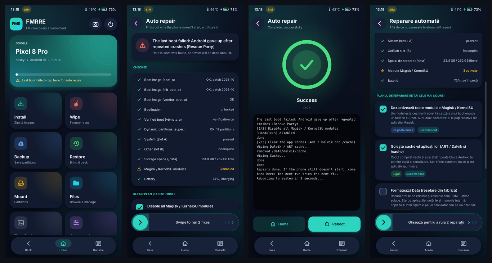

# FMRRE - FMR Recovery Environment

**Un recovery Android modern, nativ, scris de la zero, cu o interfață nouă și mult mai multe funcții.**

*Fost „TWRP v2”. Este un proiect separat, fără legătură cu TWRP-ul echipei TeamWin, dar înțelege tot ce
folosește TWRP: fstab-urile TWRP, OpenRecoveryScript, comanda `twrp` și backup-urile TWRP clasice.*

[English README](README.md)



> **Stare: experimental - NU a fost încă testat pe un telefon real.** Totul se compilează (pentru 7 arhitecturi
> de procesor, fiecare rulată și pe un procesor emulat), merge în simulatorul de pe calculator și trece toate
> testele. Încearcă-l întâi cu `fastboot boot` (nu scrie nimic pe telefon) și păstrează un recovery care merge.

## Ce face

| | |
|---|---|
| **Instalare** | Zip-uri (ROM-uri, Magisk, GApps), imagini `.img` / sparse / `.xz` / `.gz` / `.zst` / în zip, cu verificare SHA-256 după scriere |
| **ROM-uri A/B și OTA** | Instalează `payload.bin` (ROM-uri și OTA complete) în slotul inactiv, cu dm-verity și FEC calculate pe telefon; scoate imaginile boot / init_boot pentru Magisk |
| **GSI** | Expertul GSI mărește `system` în super, instalează imaginea și dezactivează AVB |
| **fastbootd propriu** | `fastboot flash` de pe calculator direct în FMRRE, cu partițiile din super redimensionate automat |
| **Reparare automată** | „Telefonul nu pornește și nu știu de ce”: verifică imaginile de boot, vbmeta, super, ambele sloturi, spațiul liber, modulele Magisk, bateria și dacă bootloader-ul e deblocat, citește jurnalele pornirii anterioare și ce a spus Android când a renunțat, plus ultima modificare făcută - apoi repară, **întâi ce e sigur**: dezactivează modulele, golește cache-ul, oprește verity, pune la loc boot-ul original, trece pe celălalt slot, verifică /data. Formatarea Data vine ultima, nu e niciodată bifată singură și nu rulează niciodată nesupravegheată |
| **Salvare din bootloop** | Explică pe înțeles de ce a eșuat ultima pornire, cu reparația potrivită lângă fiecare cauză |
| **Backup / restaurare** | Comprimat, cu SHA-256, opțional **criptat** (AES-256); citește și backup-uri TWRP clasice |
| **Root** | Magisk / KernelSU / APatch, cu backup automat al imaginii originale și manager de module |
| **MTP** | Montare → **MTP**: memoria telefonului apare pe calculator (Windows, macOS, Linux) ca să copiezi ROM-uri și backup-uri în ambele sensuri; `adb` merge în continuare |
| **Limbi** | Engleză și **română** (Setări → Limbă) |

## Pe telefon

Ai nevoie de un **bootloader deblocat** și de o imagine FMRRE făcută din recovery-ul (sau boot-ul) **telefonului
tău**:

```bash
scripts/install.sh --build-from recovery.img
```

Asta face imaginea și o pornește o dată din RAM (`fastboot boot` - nu se scrie nimic). Dacă merge:

```bash
scripts/install.sh --permanent fmrre-recovery.img
```

Samsung: `scripts/install.sh` face pachetul pentru Odin și îl instalează cu Heimdall. Pe Windows: `scripts\install.ps1`.

## De pe calculator: telefonul nu mai pornește

`pc/fmrre_rescue.py` (pe Windows: dublu-clic pe `pc\fmrre_rescue.bat`) e pentru telefoane în bootloop, blocate la o
eroare vbmeta / „verification failed” sau care **nu mai intră în recovery**. Vorbește româna singur pe un calculator
setat în română (sau cu `--lang ro`). Are nevoie de Python 3 și de Android platform-tools (`adb`, `fastboot`); pentru
Samsung, de Heimdall.

Conectezi telefonul, în orice mod ar fi, și îți spune:
- **ce telefon** e (model, nume de cod, serie, versiunea de Android)
- **în ce mod** e (Android, recovery, fastboot, fastbootd, modul Download Samsung)
- **dacă bootloader-ul e deblocat**. În modul Download Samsung calculatorul nu poate afla, așa că îți spune ce să
  citești pe ecranul telefonului (`OEM LOCK: OFF (U)`).

**Pe un telefon blocat nu instalează nimic modificat**: îți explică cum se deblochează la producătorul tău (deblocarea
șterge telefonul) și ce unealtă oficială poate reinstala firmware-ul. Singura reparație pe care o face pe un telefon
blocat este cea oficială: **`fmrre_rescue.py sideload <OTA oficial complet>.zip`** repornește telefonul în *Apply update
from ADB* și trimite OTA-ul - recovery-ul verifică singur semnătura producătorului, iar un OTA complet păstrează
aplicațiile și fișierele.

Butonul **Repară-l în locul meu** (`fmrre_rescue.py fix`) întreabă înainte de fiecare schimbare:
- slotul curent nu mai pornește, dar celălalt a mers → trece pe celălalt slot (revenire după o actualizare proastă)
- îi dai o imagine FMRRE (`--recovery`) → o pornește din RAM și rulează Repararea automată din telefon
- Samsung → instalează FMRRE (recovery + vbmeta cu verificarea oprită) sau pune la loc boot / vbmeta / recovery
  originale din fișierul AP al firmware-ului (verifică întâi MD5-ul fișierului, ca Odin)

**Reinstalarea firmware-ului oficial** (`fmrre_rescue.py factory <imagine-de-fabrică>.zip` sau butonul
*Reinstalează firmware...*): o imagine de fabrică (ca la Pixel) se instalează ca scriptul ei `flash-all`, dar **fără
`-w`, deci aplicațiile și fișierele rămân**. Imaginea trebuie să fie pentru telefonul tău - altfel nu se instalează
nimic.

Ștergerea datelor cere mereu să tastezi `ERASE`.

## Linia de comandă

```bash
adb shell fmrre autofix --dry-run
adb shell fmrre history
adb shell fmrre help
```

`twrp` merge în continuare în locul lui `fmrre`, pentru scripturile scrise pentru TWRP.

Mai multe detalii (compilare, formate, limitări cunoscute): [README.md](README.md).
